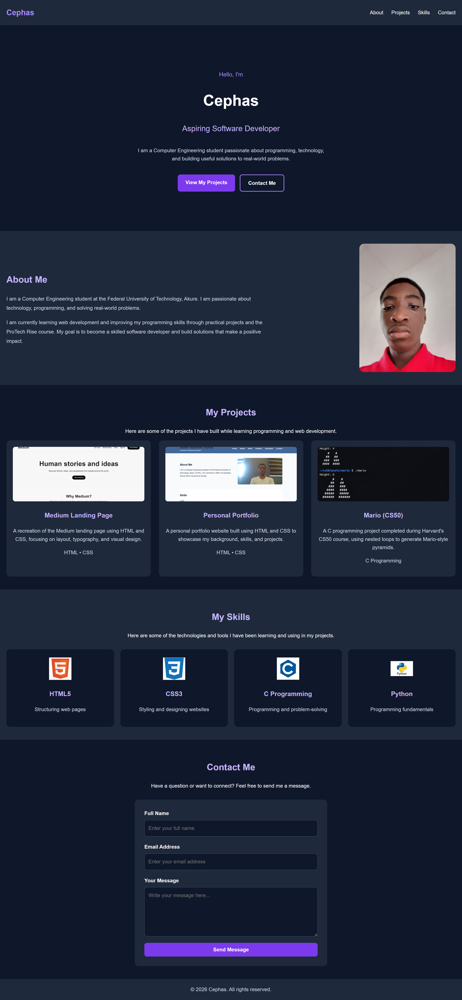

# Cephas — Personal Portfolio

## Project Description

This is my responsive personal portfolio website, developed as part of the Week 3 Frontend Development assignment at ProTech Rise Academy.

The website introduces me as an aspiring software developer and Computer Engineering student at the Federal University of Technology, Akure (FUTA). It showcases my background, technical skills, and programming projects.

The project demonstrates my understanding of semantic HTML5, CSS3, responsive web design, Flexbox, CSS Grid, and Git/GitHub.

## Features

- Responsive navigation bar
- Hero section introducing my background and interests
- About Me section with a short biography
- Projects section featuring three projects
- Skills section showcasing my current technologies
- Contact form with labeled fields and browser validation
- Responsive layouts for mobile, tablet, and desktop screens
- Footer with copyright information

## Technologies Used

- **HTML5:** Semantic structure and accessible form elements
- **CSS3:** Styling, colours, typography, and spacing
- **Flexbox:** Navigation and page layouts
- **CSS Grid:** Responsive project and skills cards
- **Media Queries:** Mobile-first responsive design
- **Git and GitHub:** Version control and project hosting

## Projects Showcased

### 1. Medium Landing Page
A recreation of the Medium landing page using HTML and CSS.

### 2. Personal Portfolio
A responsive portfolio website showcasing my background, skills, and projects.

### 3. Mario (CS50)
A C programming project completed during Harvard's CS50 course, using nested loops to generate Mario-style pyramids.

## Screenshot

## How to Run the Project

1. Download or clone this repository.
2. Open the project folder in Visual Studio Code.
3. Open `index.html` in a web browser, or use the Live Server extension.
4. Explore the website and test its responsive layout.

## Responsive Design

The website is designed to work across mobile, tablet, and desktop screen sizes, including widths from 320px to 1440px.

## Author

**Cephas**

Computer Engineering Student  
Federal University of Technology, Akure (FUTA)

## Acknowledgment

This project was developed as part of the ProTech Rise Academy Frontend Development training programme.