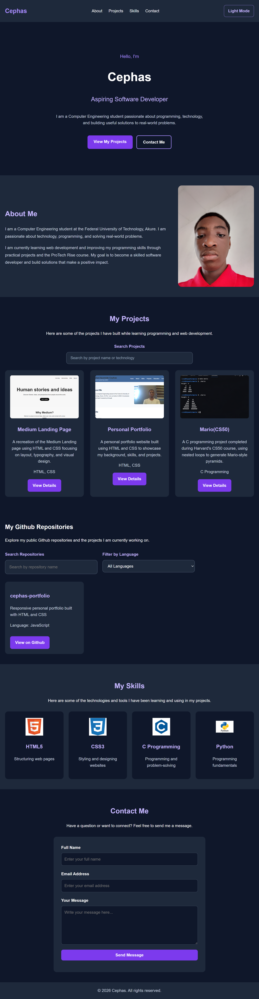
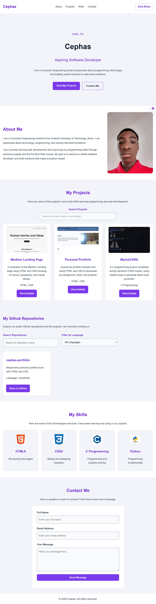

# Cephas — Personal Portfolio

## Project Description

This is my responsive personal portfolio website, developed as part of the Week 5 Cumulative Frontend Development assignment at ProTech Rise Academy.

The website introduces me as an aspiring software developer and Computer Engineering student at the Federal University of Technology, Akure (FUTA). It showcases my background, technical skills, programming projects, and public GitHub repositories.

This project builds upon my Week 3 portfolio by introducing JavaScript functionality, dynamic DOM manipulation, public API integration, form validation, and persistent user preferences.

## Features

- Responsive navigation bar
- Hero section introducing my background and interests
- About Me section with a short biography
- Dynamically generated project cards using JavaScript
- Project search by title and technology
- Expandable project details using event delegation
- GitHub API integration to display public repositories
- Repository search and programming language filtering
- API loading, error, and empty states
- Skills section showcasing my current technologies
- Contact form with JavaScript validation and accessible error messages
- Light and dark mode toggle
- Persistent theme preference using localStorage
- Responsive layouts for mobile, tablet, and desktop screens
- Footer with copyright information

## Technologies Used

- **HTML5:** Semantic structure and accessible form elements
- **CSS3:** Styling, colours, typography, and spacing
- **JavaScript (ES6+):** Dynamic content, event handling, filtering, and form validation
- **Flexbox:** Navigation and page layouts
- **CSS Grid:** Responsive project and skills cards
- **Media Queries:** Mobile-first responsive design
- **GitHub REST API:** Fetching and displaying public repository data
- **LocalStorage:** Saving and restoring user theme preferences
- **Git and GitHub:** Version control and repository hosting

## JavaScript Concepts Applied

- Variables using const and let
- Arrays and objects
- Functions and return values
- Array methods such as map, filter, and forEach
- DOM manipulation using createElement and textContent
- Event listeners and event delegation
- Asynchronous programming using async and await
- Fetch API
- Regular expressions for email validation
- JSON.stringify() and JSON.parse()
- Error handling using try/catch
- Browser localStorage

## Projects Showcased

### 1. Medium Landing Page

A recreation of the Medium landing page using HTML and CSS, focusing on layout, typography, and visual design.

### 2. Personal Portfolio

A responsive portfolio website showcasing my background, skills, and projects, enhanced with interactive JavaScript features.

### 3. Mario (CS50)

A C programming project completed during Harvard's CS50 course, using nested loops to generate Mario-style pyramids.

## GitHub API Integration

The website retrieves public repository information from the GitHub REST API and dynamically displays repository names, descriptions, programming languages, and links.

Visitors can search repositories by name and filter them by programming language.

The application also handles loading states, unsuccessful API requests, and empty search results.

## Contact Form Validation

The contact form uses JavaScript to validate user input before accepting it.

Validation includes:

- Removing unnecessary whitespace using trim()
- Minimum name and message lengths
- Email format validation using regular expressions
- Accessible error messages
- Prevention of default form submission when handling validation

The contact form demonstrates client-side validation and is not connected to a backend or email delivery service.

## Theme Preference

Visitors can switch between light and dark mode.

The selected theme is saved using localStorage and restored when the website is refreshed. JSON methods and try/catch are used to store, retrieve, and safely handle malformed preference data.

## Screenshot

### Dark Mode

### Light Mode

## How to Run the Project

1. Download or clone this repository.
2. Open the project folder in Visual Studio Code.
3. Open `index.html` in a web browser or use the Live Server extension.
4. Ensure an internet connection is available for the GitHub API integration.
5. Explore the website and test its interactive features.

## Responsive Design

The website is designed to work across mobile, tablet, and desktop screen sizes, including widths from 320px to 1440px.

Flexbox, CSS Grid, and media queries are used to create flexible and responsive layouts.

## Accessibility

The website incorporates:

- Semantic HTML5 elements
- Meaningful image alternative text
- Properly labelled form inputs
- Accessible form validation messages
- Visible keyboard focus indicators
- Accessible expandable project details
- Live status messages for API requests

## Limitations

- The contact form performs client-side validation only and does not send messages.
- GitHub repository data depends on internet connectivity, API availability, and API rate limits.
- Theme preferences are stored locally in the visitor's browser.

## Author

**Cephas**

Computer Engineering Student  
Federal University of Technology, Akure (FUTA)

## Acknowledgment

This project was developed as part of the ProTech Rise Academy Frontend Development training programme, building upon the Week 3 portfolio assignment and incorporating the Week 5 JavaScript and API integration requirements.